# LeetCode's Official Editorial

### Approach 1: Recursive Parsing

#### Intuition

An expression consists of subexpressions separated by commas (representing the union operation) or directly concatenated (representing the Cartesian product). Because concatenation has higher precedence than union, evaluating the expression is analogous to evaluating arithmetic expressions where concatenation corresponds to multiplication and comma separation corresponds to addition. Therefore, the expression is first parsed as a comma-separated sequence of terms whose union forms the final result.

We use expr to represent an arbitrary expression and term to represent an expression that has no comma at its outermost level. Then expr can be decomposed according to the following rule:

expr→term ∣ term,expr

Here, ∣ denotes alternative productions; that is, expr decomposes into either a single term or a term followed by a comma and another expr.

Next, consider term. A term can be formed by directly concatenating lowercase English letters or expressions enclosed in braces. We use item to represent each concatenated unit. Then term can be decomposed according to the following rule:

term→item ∣ item term

An item can be further decomposed into a lowercase English letter letter or an expression enclosed in braces. Its decomposition is as follows:

item→letter ∣ {expr}

In the code, we write three functions that are responsible for the three decomposition rules above:

1. The expr function repeatedly calls term and takes the union with its result. It returns when it reaches the end of the expression or when the current character is not a comma.
2. The term function repeatedly calls item and takes the product with its result. It returns when it reaches the end of the expression, or when the current character is neither a lowercase letter nor a left brace.
3. The item function evaluates a single unit. If the current character is a left brace {, it skips {, recursively calls expr, skips the matching closing brace }, and returns the result. Otherwise, it constructs a set containing only the current character, advances the pointer, and returns the set.

The following diagrams use {a,b}{c,{d,e}} as an example to show the entire process of recursively decomposing and backtracking through the expression.

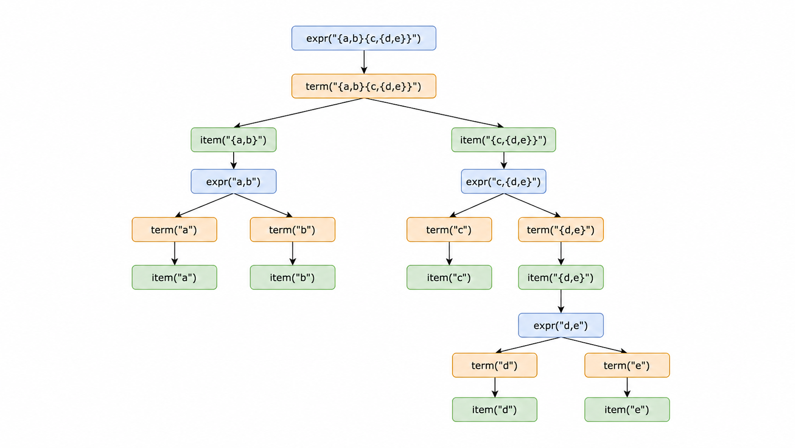

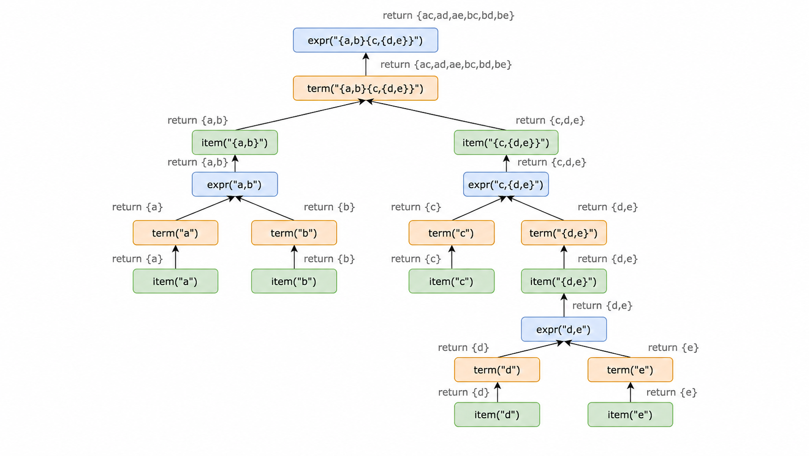

A few implementation details to note:

1. Maintain an external pointer to traverse the entire expression, or pass the expression and the current traversal index by reference to the called function.
2. Since the final answer needs to be deduplicated, we can first use sets to compute the intermediate results and finally convert them into a sorted list as the answer.

#### Complexity Analysis

Let n be the length of expression, and M be the maximum number of words in any set (M≤2n/5 in the worst case).

- Time complexity: O(n⋅M).

 Traversal takes O(n) time, while intermediate Cartesian products and unions process up to M strings of length up to O(n). With n≤60, M≤4096, easily running within time limits.

- Space complexity: O(n⋅M).

 Dominated by storing intermediate and final sets of strings of length up to O(n), alongside O(n) recursion stack space.

### Approach 2: Stack

#### Intuition

If we regard the union operation (represented by commas) in the expression as addition and concatenation as multiplication, the process of evaluating the entire expression becomes analogous to evaluating an arithmetic infix expression. For example, {a,b}{c,{d,e}} can be viewed as {a,b}×{c+{d+e}}.

As with evaluating an infix expression, we need two stacks while traversing the expression: one stores the operators (namely the plus sign, multiplication sign, and left brace), and the other stores the operands (namely the sets).

Because concatenation is implicit in the grammar, we must insert multiplication operators ourselves during traversal. A multiplication operator is required whenever a subexpression ends and another immediately begins: specifically, when the preceding character can end an operand (a lowercase letter or }) and the current character can start an operand (a lowercase letter or {). In all other cases (e.g., before , or }), no multiplication is inserted.

Next, we consider operator precedence. In standard arithmetic, multiplication has higher precedence than addition. Similarly here, concatenation must be evaluated before union; therefore, multiplication has higher precedence than addition.

At this point, we can evaluate the expression according to the following procedure:

1. If we encounter ,, we first check whether the top of the operator stack is a multiplication sign. If so, we need to perform the multiplication first, until the top is no longer a multiplication sign, and then push a plus sign onto the operator stack.
2. If we encounter {, we first determine whether a multiplication sign needs to be added, and then push { onto the operator stack.
3. If we encounter }, we repeatedly pop the top operator from the operator stack and perform the calculation until the top is a left brace {, then pop the left brace.
4. If we encounter a lowercase English letter, we first determine whether a multiplication sign needs to be added, then construct a set of strings containing only the current lowercase letter and push it onto the set stack.

After traversing the expression once according to the procedure above, the outermost layer of the given expression may not have braces, such as {a,b}{c,{d,e}}. Therefore, there may still be elements in the operator stack. We need to pop and evaluate them one by one. Finally, the element at the top of the set stack is the answer.

The diagrams below show the entire evaluation process using {a,b}{c,{d,e}} as an example:

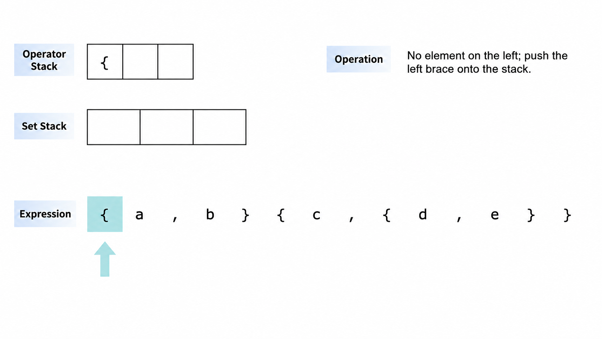

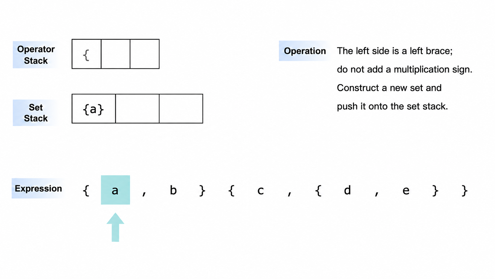

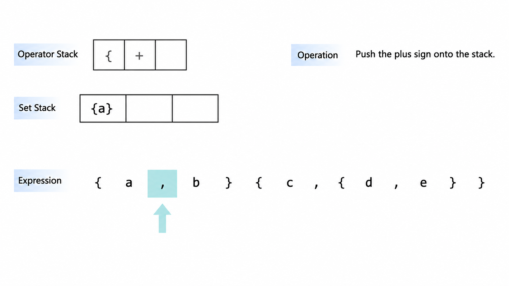

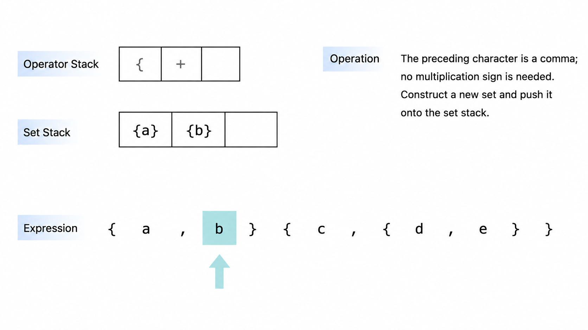

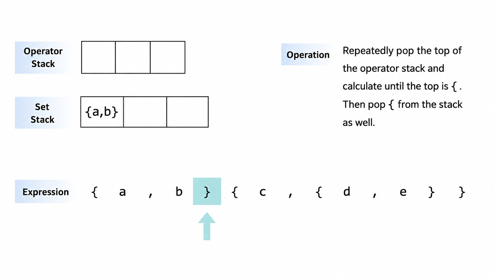

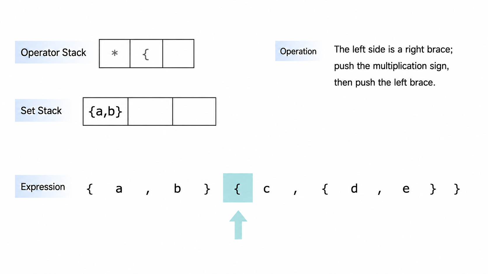

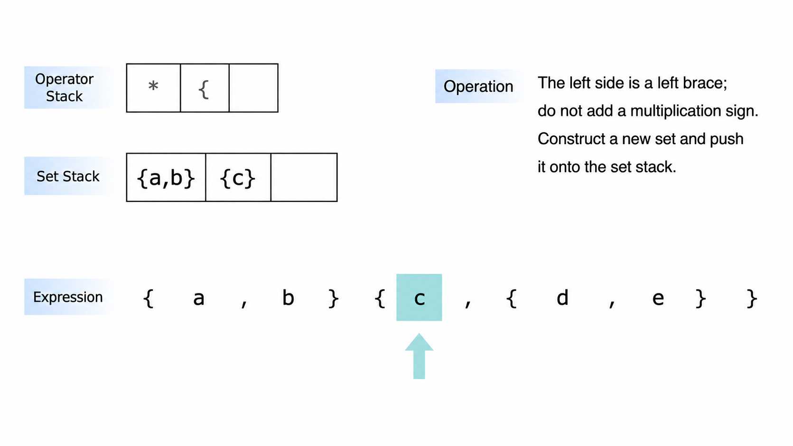

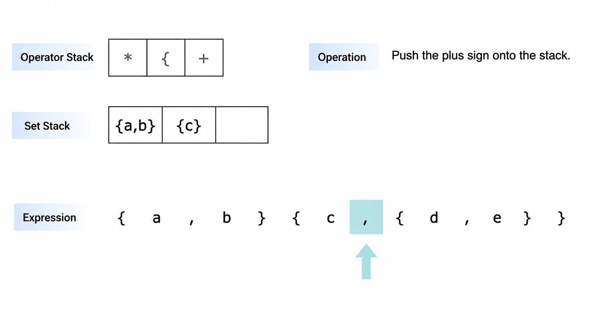

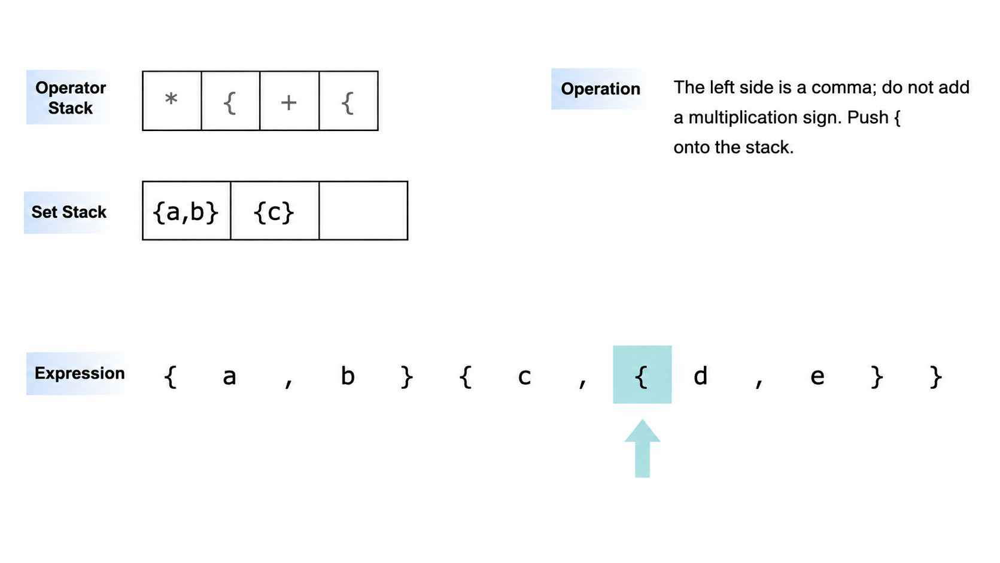

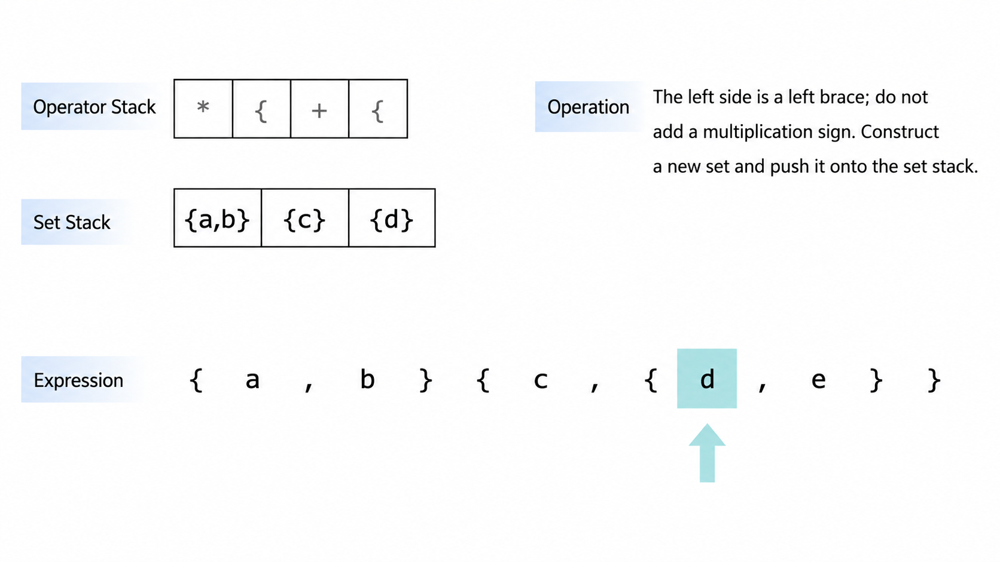

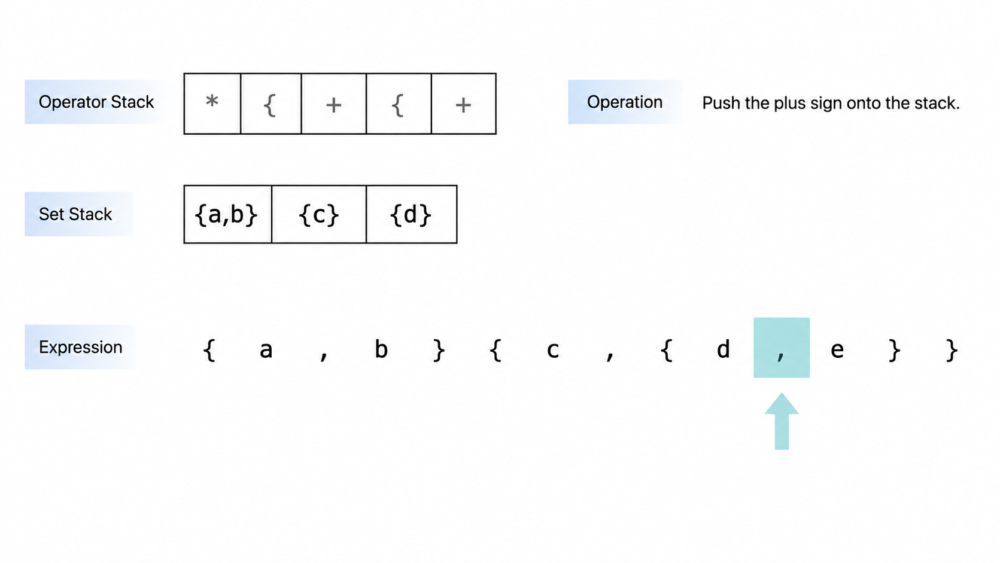

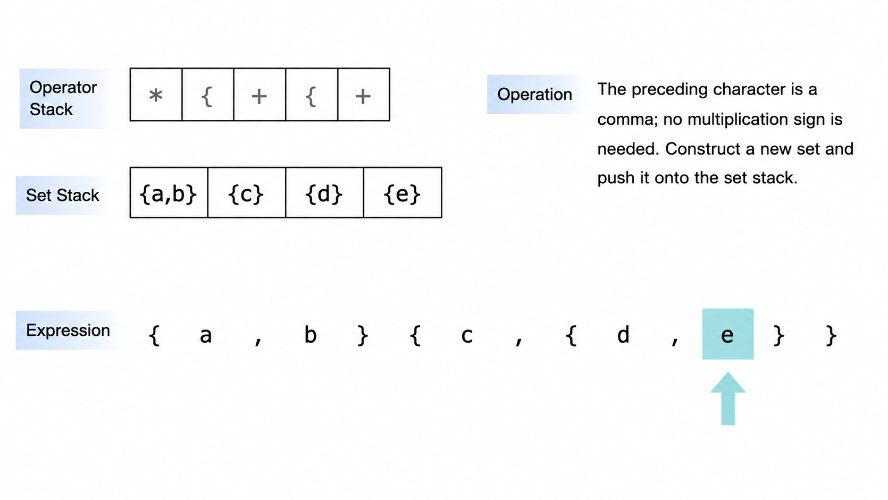

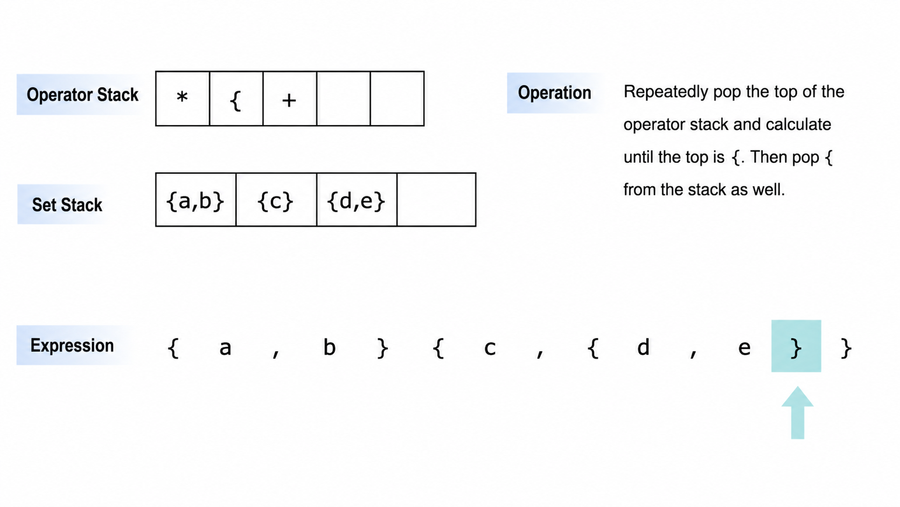

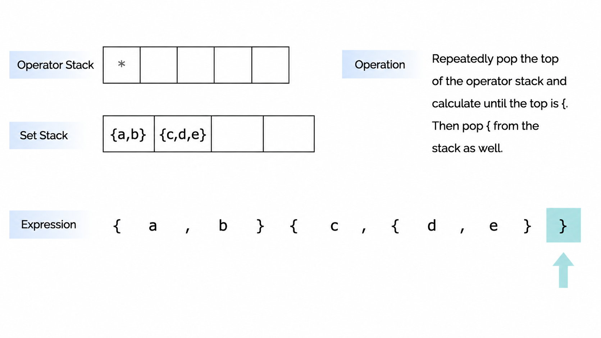

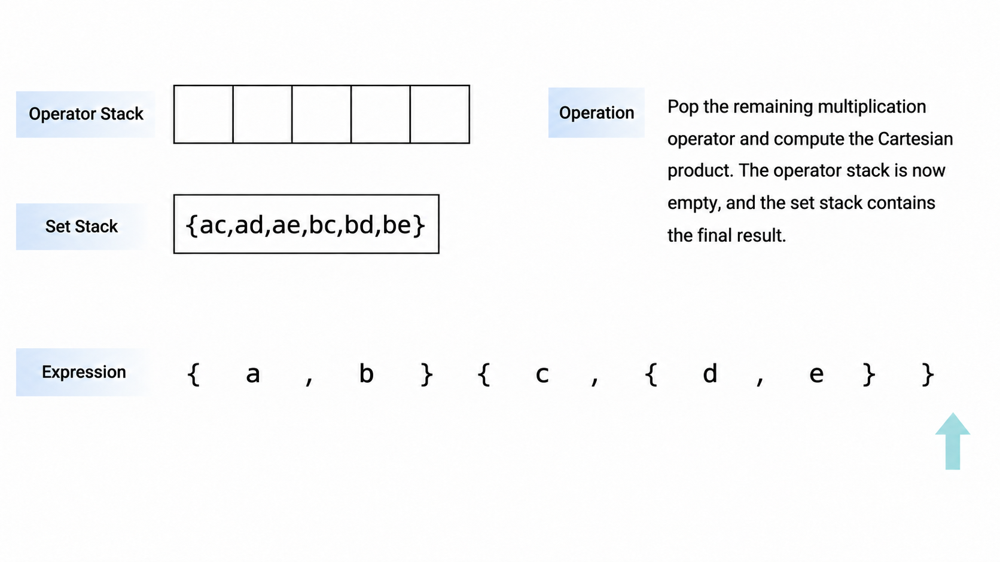

#### Complexity Analysis

Let n be the length of expression, and M be the maximum number of words in any set (M≤2n/5 in the worst case).

- Time complexity: O(n⋅M)

 Stack operations take O(n) time, while evaluating intermediate Cartesian products and unions processes up to M strings of length up to O(n). Because n≤60, M remains small, ensuring fast execution.

- Space complexity: O(n⋅M)

 Dominated by storing sets of strings on the operand stack, along with O(n) space for the stack structures themselves.

---
